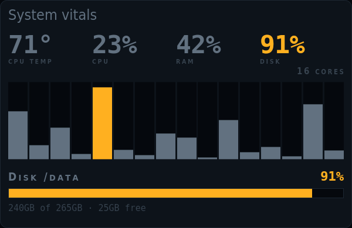

# kiosko-plugin-vitals

The machine at a glance, quiet until something runs hot or fills up. Needs the system vitals source.

A plugin for [Kiosko](https://github.com/kiosko-lcd/kiosko), the widget mosaic for small USB LCD panels.



## Install

In Kiosko, **Plugins → Install from npm** → `kiosko-plugin-vitals`, then restart Kiosko. Or from a terminal:

```sh
npm install --prefix ~/.config/kiosko/plugins kiosko-plugin-vitals
```

(macOS: `~/Library/Application Support/Kiosko/plugins`, Windows: `%APPDATA%\Kiosko\plugins`.)

## Requirements

- The `system/vitals` source from [kiosko-plugin-system](../kiosko-plugin-system).

## Widgets

### System vitals — `vitals/vitals`

CPU temperature, CPU, RAM and disk in dim ink that only turns amber or red past your thresholds; per-core bars when wide.


Uses: `system/vitals`.

| Option | Type | Default | |
|---|---|---|---|
| `cpuWarn` | number | `85` | Amber CPU from. Overall and per core. |
| `cpuAlert` | number | `95` | Red CPU from |
| `ramWarn` | number | `85` | Amber RAM from |
| `ramAlert` | number | `95` | Red RAM from |
| `diskWarn` | number | `85` | Amber disk from |
| `diskAlert` | number | `95` | Red disk from |
| `tempWarn` | number | `85` | Amber temperature |
| `tempAlert` | number | `95` | Red temperature |
| `showCores` | boolean | `true` | Per-core bars |
| `perCoreMinWidth` | number | `420` | Per-core bars from this width |
| `showDisk` | boolean | `true` | Disk bar |

## Development

```sh
npm install
npm test          # node:test
npm run check     # TypeScript
npm run build     # dist/index.js, what Kiosko loads
```

To try it in a running Kiosko without publishing: `kiosko plugins link .` and restart Kiosko.

Working on Kiosko and its plugins together: clone them side by side
(`kiosko/` and `kiosko-plugins/kiosko-plugin-vitals/`) and run `npm install` in
`kiosko/`; its workspaces link every plugin found in `../kiosko-plugins`.

## License

MIT
